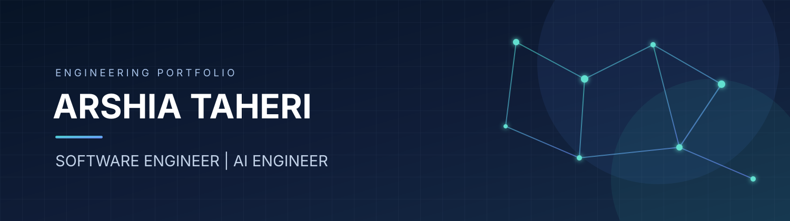

<h1 align="center">Arshia Taheri</h1>
<h3 align="center">AI / ML Engineering · LLM Applications · Backend Systems</h3>

  <a href="https://github.com/arshiataheri851-ops">GitHub</a> ·
  <a href="https://www.linkedin.com/in/arshia-taheri-5b85b33b2/">LinkedIn</a>

---

## Profile

I work across **applied machine learning, generative AI, backend engineering, and data systems**. My focus is on building useful, maintainable software around models: from data preparation and evaluation to API integration, deployment, and monitoring.

I am especially interested in production-oriented AI systems, Persian-language NLP, retrieval-based applications, and reliable model-serving infrastructure.

## Engineering focus

| Area | Focus |
|---|---|
| **Applied ML** | Predictive modeling, classification, model evaluation, feature engineering |
| **Generative AI** | LLM applications, RAG pipelines, embeddings, agent workflows |
| **NLP & Speech** | Text classification, sentiment analysis, Persian-language use cases, ASR evaluation |
| **Backend** | Python services, REST APIs, FastAPI, Django, integrations |
| **Data engineering** | SQL, PostgreSQL, ETL workflows, data processing |
| **MLOps & delivery** | Model serving, Docker, Kubernetes, experiment tracking, monitoring |

## Technology

  
  
  
  
  
  
  

  
  
  
  
  
  
  
  

## Project directions

The following are the engineering themes I use to guide portfolio work. Each implementation will be linked here once its code, setup instructions, and evaluation notes are published.

- [Portfolio project roadmap](docs/PROJECT_ROADMAP.md)
- [Reusable project showcase template](docs/PROJECT_SHOWCASE_TEMPLATE.md)

### 1. Real-time market intelligence & risk analytics
Data ingestion for market and order-book feeds, feature generation, analytical signals, and risk notifications.

### 2. Persian NLP & speech technology
Text classification, sentiment analysis, and speech-recognition evaluation for Persian-language data.

### 3. Production-ready model serving
A tested inference API with input validation, model versioning, Docker-based deployment, logging, and monitoring.

### 4. Retrieval-augmented AI applications
Document ingestion, chunking, embeddings, retrieval evaluation, grounded generation, and source-aware answers.

## How I approach engineering

- **Evidence over claims:** document measurable results and evaluation methodology.
- **Reliable delivery:** use clear interfaces, tests, version control, and reproducible setup steps.
- **Operational thinking:** consider latency, observability, security, and maintainability.
- **Clear communication:** document assumptions, decisions, limitations, and handover details.

## Contact

- GitHub: [@arshiataheri851-ops](https://github.com/arshiataheri851-ops)
- LinkedIn: [Arshia Taheri](https://www.linkedin.com/in/arshia-taheri-5b85b33b2/)

---

Building practical AI systems with strong software engineering foundations.

