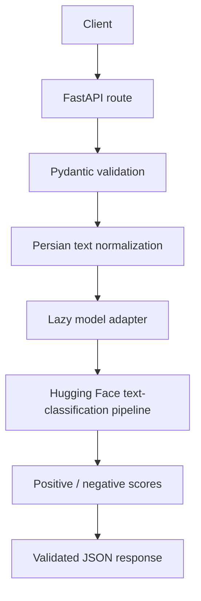

# Architecture

## Request flow

## Components

- `app/main.py`: application factory, service metadata, health check, and inference routes.
- `app/schemas.py`: request and response contracts with input-size limits.
- `app/normalization.py`: conservative normalization for Persian/Arabic character variants.
- `app/predictor.py`: lazy Hugging Face adapter and label mapping.
- `app/config.py`: environment-backed settings and pinned model reference.
- `scripts/evaluate.py`: optional, local-only evaluation against the referenced test split.

## Model loading

The application can start without importing Transformers or downloading model weights. The model is loaded on the first prediction request and kept in memory for later requests. The initial implementation explicitly targets CPU with `device=-1`; deployments can change this adapter as a separately tested enhancement.

## Failure handling

- Invalid and blank input is rejected by Pydantic with HTTP 422.
- Model download, dependency, or inference failures return HTTP 503 with a generic message. Exception details are logged server-side; input text is not logged.
- `GET /health` reports whether the model has loaded without causing model initialization.

## Operational considerations

- Put an authentication layer and rate limiting in front of the service before exposing it publicly.
- Persist the Hugging Face cache in Docker or other container deployments.
- Monitor request latency, model initialization time, memory usage, and HTTP 5xx rates.
- Do not send private or sensitive user text to external inference providers. This implementation downloads public model artifacts but runs inference locally.

## Known limitations

- Binary polarity only; no neutral output.
- Training domain is SnappFood-style reviews.
- Model score is not calibrated confidence.
- No model fine-tuning or retraining pipeline is included in this first version.
